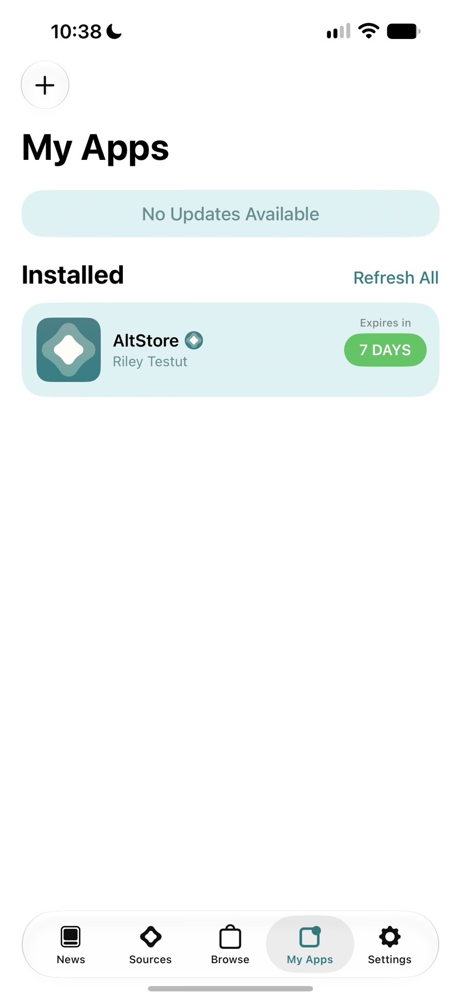
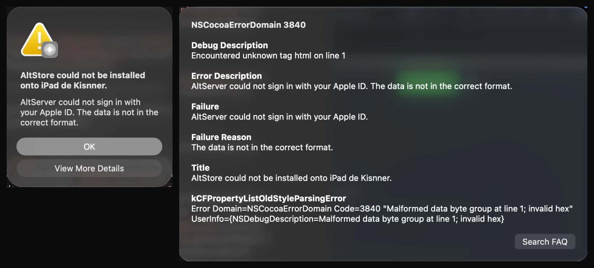

# altserver-80045

field notes on why altserver stopped signing in to apple on macos 27 in october 2026, how apple blocked it twice, and the fix proposed to altstore.

## what happened

- **oct 12**: every sign-in fails at the first grandslam request with `-80045`. altserver on macos 27 generated android anisette data while reporting a mac client info.
- **oct 14, ~20:50 utc**: apple starts answering any android client info with a `503` html page. altserver shows it as "the data is not in the correct format" (`NSCocoaErrorDomain 3840`).
- **what passes**: windows anisette data from an anisette v3 server, with the client info and user agent that server reports.

## the fix

- altstore: [altstoreio/AltStore#1834](https://github.com/altstoreio/AltStore/pull/1834)
- altsign: [rileytestut/AltSign#61](https://github.com/rileytestut/AltSign/pull/61)
- unofficial build, temporary: [release](https://github.com/kisnner26/AltStore/releases/tag/v1.8-windows-anisette-unofficial)
- tracking issue: [altstoreio/AltStore#1828](https://github.com/altstoreio/AltStore/issues/1828)

tested on macos 27.2 with a free apple id with 2fa: sign-in, install on an ipad pro and an iphone 15 pro max, and a refresh of altstore (6 requests, all http 200, back to 7 days). not tested: refreshing other sideloaded apps. not universal: some accounts still get `-80045` with the windows identity.

## the article

the full write-up, with the timeline, the probes against the edge and a crash caused by an empty framework in xcode 27, is at [kisnner26.github.io/altserver-80045](https://kisnner26.github.io/altserver-80045/) (source in [`index.html`](index.html)). a short version is in this [thread on x](https://x.com/kisnnerc/status/2110793388354158813).

not affiliated with altstore or apple.
